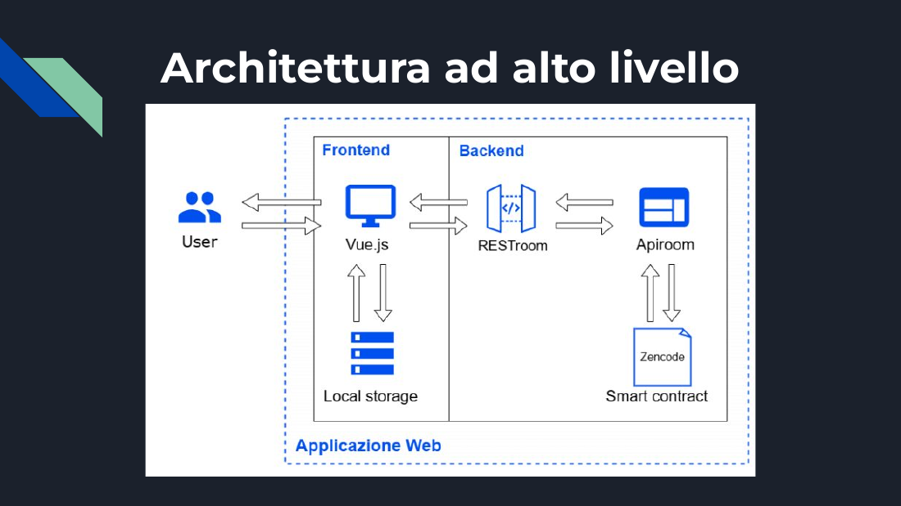
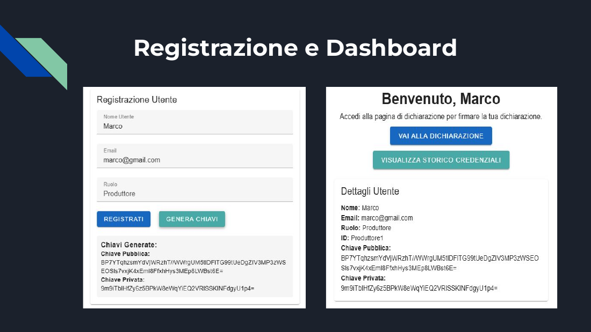
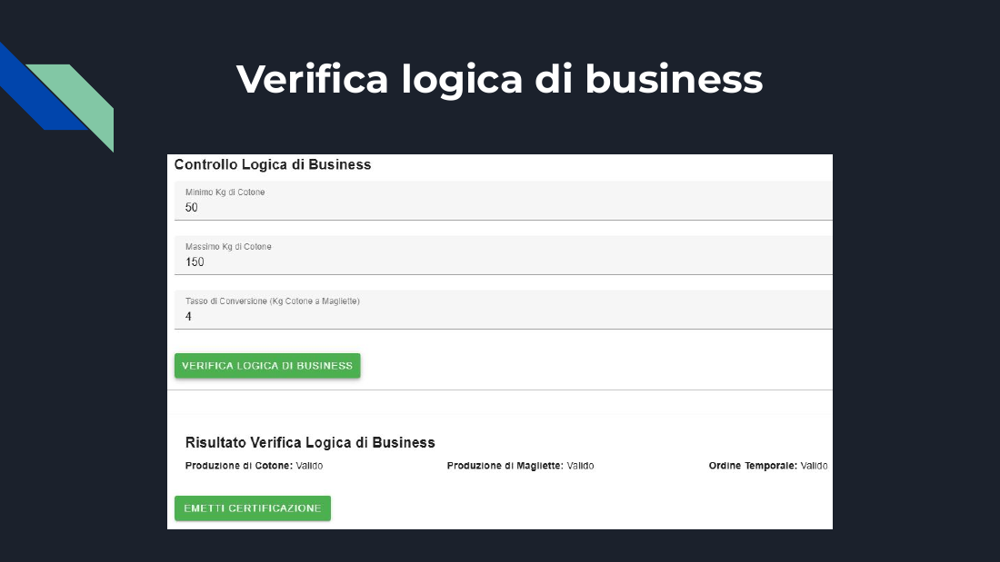

# Blockchain Data Governance for Supply Chains

**Bachelor's thesis project** – *Design and implementation of a framework for data governance on blockchain*
Roma Tre University · Academic year 2023/2024
Supervisor: Prof. Maurizio Patrignani · Co-supervisor: Dr. Fabio Lecca

A web application that lets the actors of a supply chain **sign, share and verify declarations** using **W3C Verifiable Credentials**, **Decentralized Identifiers (DIDs)** and **smart contracts written in Zencode**. The use case is a **cotton supply chain**: a farmer declares how much cotton was produced, a manufacturer declares how many t-shirts were made, and an auditor verifies both signatures, checks the business rules and issues a signed sustainability certificate.



---

## The problem

Modern supply chains struggle with:

- **Lack of trust**: participants have no tools to verify the integrity of shared data.
- **Limited transparency**: data about processes and agreements is not always accessible or verifiable by every party.
- **Complex agreements**: without shared standards it is hard to define clear rules that no single party can change.

The framework addresses this by turning every declaration into a **cryptographically signed Verifiable Credential** and moving the verification logic into **smart contracts** that anyone can read.

## How it works

| Role | What they do |
|---|---|
| **Farmer** (*Coltivatore*) | Registers, generates a key pair, and signs a credential declaring the kg of cotton produced |
| **Manufacturer** (*Produttore*) | Signs a credential declaring the number of t-shirts produced |
| **Auditor** (*Verificatore*) | Verifies both signatures, runs the business-logic check and issues a signed sustainability certificate |

**Flow**

1. **Registration and key generation**: each user picks a role and gets a key pair generated by a Zencode contract. A DID such as `did:supplychain:Produttore1` is assigned.
2. **Declaration and signature**: the user fills in the declaration, the app builds a W3C Verifiable Credential and a Zencode contract signs it.
3. **Signature verification**: the auditor selects the two credentials and verifies each signature.
4. **Business-logic check**: a Zencode contract checks the rules of the supply chain (minimum/maximum kg of cotton, cotton-to-t-shirt conversion rate, temporal order of the declarations).
5. **Certificate issuance**: if every check passes, the auditor issues a signed `AuditCredential` with a sustainability claim.
6. **History**: each user can browse the credentials they have issued.

| Registration & dashboard | Business-logic check |
|---|---|
|  |  |

More screens: [declaration signing](docs/images/declaration-signing.png) · [signature verification](docs/images/signature-verification.png) · [certificate](docs/images/certificate.png)

## Tech stack

- **Frontend**: Vue 3 (Composition + Options API), TypeScript, Vite, Vuetify 3, Vue Router, Pinia, Axios
- **Smart contracts**: [Zencode](https://dev.zenroom.org/), a declarative, human-readable smart-contract language based on Gherkin syntax, from the Forkbomb / Dyne.org ecosystem
- **Backend**: contracts deployed on **ApiRoom** and exposed as REST endpoints through **RESTroom**
- **Standards**: W3C Verifiable Credentials, Decentralized Identifiers (DIDs)
- **Tooling**: ESLint, Prettier, Vitest

## Project structure

```
src/
├── views/
│   ├── Register.vue                  # sign-up + key-pair generation
│   ├── Login.vue
│   ├── Dashboard.vue                 # role-based entry point
│   ├── Dichiarazione.vue             # farmer declaration (cotton kg)
│   ├── DichiarazioneProduttore.vue   # manufacturer declaration (t-shirts)
│   ├── DichiarazioneVerificatore.vue # signature + business-logic verification
│   ├── Certificato.vue               # signed sustainability certificate
│   ├── Storico.vue                   # credential history
│   └── genKey.vue                    # standalone signature check
├── router/index.ts
└── main.ts                           # Vue + Vuetify + Pinia setup
docs/
├── thesis-presentation-it.pdf        # thesis defense slides (Italian)
└── images/
```

## Getting started

Requirements: **Node.js 18+** and npm.

```bash
git clone https://github.com/bogX2/blockchain-data-governance.git
cd blockchain-data-governance
npm install
npm run dev        # http://localhost:5173
```

Other scripts:

```bash
npm run build      # type-check + production build
npm run test:unit  # unit tests (Vitest)
npm run lint       # ESLint
```

**Try the full flow**: register three users (one per role), sign a declaration as the farmer and as the manufacturer, then log in as the auditor to verify and certify.

> **Note:** signing and verification call Zencode contracts hosted on ApiRoom (`https://apiroom.net/api/bogx2/...`). If those endpoints are no longer online, the UI still runs but those steps will fail.

## Limitations and future work

This is a **research prototype**, not a production system:

- Users and keys are stored in the browser's `localStorage`, and private keys are sent to the signing contract. A real deployment would use **decentralized wallets** so keys never leave the user's device.
- The contracts are not yet anchored on a ledger. The next step is deployment on **Hyperledger Fabric**.
- Other ideas explored in the thesis: a **JSON-to-smart-contract parser** and machine learning support for writing Zencode.

## Author

**Bogdan Andrei Tutuianu** – [GitHub](https://github.com/bogX2)
